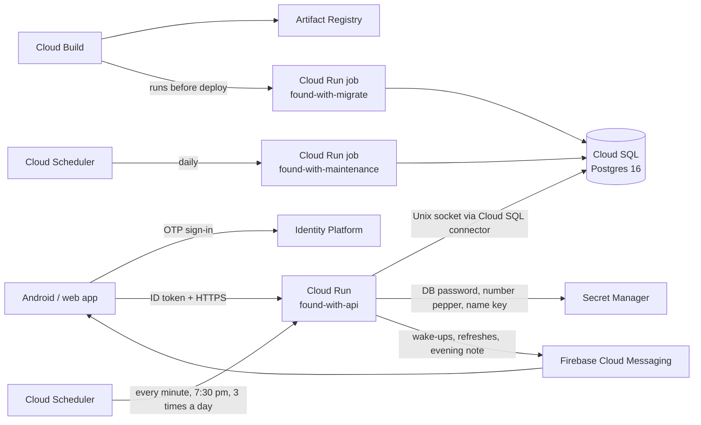

# Found With

For any phone number, see who on Found With has it in their contacts or call log: by name for people you know, as a count for the rest. On your Home tabs, when you search a number, and in a notification after a call.

| Folder | What's in it |
|---|---|
| `prototype/` | The first clickable web prototype (one HTML file). Out of date: the app follows `docs/DESIGN.md` |
| `android/` | The Android app (Kotlin, Jetpack Compose): sign-in, Home (Updates, Calls, Contacts), search, number cards, after-call notifications, invites, phone fixes by brand, background sync |
| `backend/` | API in Python (Starlette, asyncpg), the invite and opt-out web pages, push, migrations, jobs and tests |
| `infra/terraform/` | Everything on GCP: Cloud Run, Cloud SQL, Secret Manager, Identity Platform, Firebase Cloud Messaging, Scheduler, alerts |
| `cloudbuild.yaml` | CI/CD: test → build → migrate → deploy → smoke test |
| `.github/workflows/android.yml` | Builds and tests the Android app on GitHub, and keeps the APKs |
| `docs/DESIGN.md` | The final design: every screen, the number rule, messages, after-call notifications |
| `docs/SPEC.md` | Product rules, data handling, API reference, error codes, open items |

## How it fits together



- **Region:** `asia-south1` (Mumbai), so data stays in India.
- **No phone numbers in the database.** Every number is stored as `HMAC-SHA256(pepper, E.164)`.
- **Contact names are encrypted.** Each is stored with AES-GCM under a key derived from `NAME_KEY` and bound to its number, plus a keyed hash so identical names can be counted. A name is only ever shown to others as a number's **popular name**: the one at least 3 established accounts saved.
- **Sign-in:** phone OTP through Identity Platform, with SMS limited to Indian numbers. The API verifies ID tokens itself.
- **Scale to zero:** Cloud Run costs nothing when idle. Cloud SQL is the main fixed cost.

## Run the tests

```bash
cd backend
pip install -r requirements-dev.txt
python -m pytest
```

The tests start a throwaway Postgres if the server binaries are installed (`apt install postgresql`). To use an existing server instead:

```bash
TEST_DATABASE_URL="host=localhost user=postgres password=postgres" python -m pytest
```

The suite (239 tests) covers the matching rules, contacts and call logs both counting, hidden numbers, opt-out (with and without deleting the account), blocks, name rules, contact names and popular names, the evening note, wake-ups, health by brand, the app-version gate, the invite and opt-out pages, moderation by number, sync on/off, quotas and allowances, stored holder counts staying exact through every kind of change, the changes endpoint, recycled numbers, account deletion and inactivity, the v0.1 → current database upgrade, token verification and the HTTP layer. `test_asyncpg_driver.py` runs the main flow through the production driver and is skipped where asyncpg isn't installed. Cloud Build installs it, so every deploy runs it.

## Check real-time latency

```bash
cd backend
python -m tests.perf_check --users 50000     # about 11 million stored numbers, 4 minutes to build
```

It starts a throwaway Postgres, fills it with address books shaped like real ones, and times the incoming-call lookup, search, Home cards, the holder list, a one-contact change and a full sync. Run it before and after any change to the matching queries. Results from 12 Nov 2026 are in `docs/SPEC.md`, section 3.

`python -m tests.concurrency_check` runs 16 people syncing the same popular numbers at once and fails if any sync fails or the stored holder counts drift. Run it after any change to how syncs write.

## Run the API on your laptop

```bash
docker run -d --name fw-pg -e POSTGRES_PASSWORD=postgres -e POSTGRES_DB=foundwith -p 5432:5432 postgres:16

cd backend
pip install -r requirements.txt
export APP_ENV=development AUTH_MODE=dev \
       DB_HOST=localhost DB_USER=postgres DB_PASSWORD=postgres DB_NAME=foundwith \
       NUMBER_PEPPER=local-dev-pepper-keep-this-the-same-0001 \
       NAME_KEY=local-dev-name-key-different-from-pepper-01 PUSH_MODE=log
python -m foundwith.migrate
uvicorn foundwith.api:create_app --factory --reload --port 8080
```

With `AUTH_MODE=dev`, use `dev:<number>` as the token:

```bash
H='Authorization: Bearer dev:+919845031207'
curl -s -X POST localhost:8080/v1/me -H "$H" -d '{"display_name":"Arjun Rao"}'
curl -s -X PUT localhost:8080/v1/me/sync -H "$H" -d '{"enabled":true,"consent_version":"2026-11-16"}'
curl -s -X PUT localhost:8080/v1/me/numbers -H "$H" -d '{"contacts":[{"number":"98451 72046","name":"Raju Plumber"}],"call_log":[]}'
curl -s localhost:8080/v1/cards -H "$H"
```

Dev sign-in is refused when `APP_ENV=production`. With `PUSH_MODE=log`, pushes are written to the log instead of sent.

The web pages are at `localhost:8080/i/<invite code>` (the invite page) and `localhost:8080/out` (take a number out of Found With; it needs `FIREBASE_WEB_API_KEY` for the SMS code).

## Deploy to GCP

You need a project with billing, `gcloud`, and Terraform 1.6 or later.

**0. Log in.**

```bash
export PROJECT_ID=your-project-id
gcloud auth login
gcloud auth application-default login
gcloud config set project $PROJECT_ID
gcloud auth application-default set-quota-project $PROJECT_ID
gcloud services enable cloudresourcemanager.googleapis.com serviceusage.googleapis.com
```

**1. State bucket.** Create it as shown in `infra/terraform/backend.tf.example`, then rename that file to `backend.tf`. State holds the database password and the number pepper, so only admins should read the bucket.

**2. Infrastructure.**

```bash
cd infra/terraform
cp terraform.tfvars.example terraform.tfvars   # set project_id, alert_email, test numbers, firebase_web_api_key
terraform init
terraform apply
```

The first apply starts the service and jobs with Google's placeholder image. Terraform ignores image changes after that, because Cloud Build owns deployments.

`firebase_web_api_key` is the **Web API key** from Firebase's Project settings; the opt-out page uses it to send its SMS code. Add the API's domain (`terraform output -raw api_url`, without `https://`) under Firebase Authentication, Settings, **Authorised domains**, or the page's SMS step fails.

The apply also creates three Cloud Scheduler jobs that call the API with an OIDC token: pushes every minute, the evening note at 7:30 pm IST, and wake-ups at 10 am, 2 pm and 6 pm. `push_mode` defaults to `fcm`.

**3. CI/CD.** Connect the GitHub repository in Cloud Build (Repositories, 2nd gen), then create a trigger on `main` that uses `cloudbuild.yaml` and the deployer service account from `terraform output deployer_service_account`:

```bash
gcloud builds triggers create github --name=found-with-main --region=asia-south1 \
  --repository=projects/PROJECT_ID/locations/asia-south1/connections/CONNECTION/repositories/REPO \
  --branch-pattern='^main$' --build-config=cloudbuild.yaml \
  --service-account=projects/PROJECT_ID/serviceAccounts/found-with-deployer@PROJECT_ID.iam.gserviceaccount.com
```

Every push to `main` then tests, builds, runs migrations, deploys and checks `/readyz`.

**4. Check it.**

```bash
curl "$(terraform output -raw api_url)/readyz"
```

## Moderation

The app has no report button: complaints come to the help address and name a number ("this number calls itself SBI", "people saved me as Fraud"). Moderation is done with one-off runs of the maintenance job, so no admin endpoint is exposed to the internet. The job never gets the number pepper, so first turn the number into its hash on your own machine:

```bash
cd backend
NUMBER_PEPPER="$(gcloud secrets versions access latest --secret=found-with-number-pepper)" \
  python -m foundwith.admin hash "+91 98450 31207"
```

Then, with that hash:

```bash
run() { gcloud run jobs execute found-with-maintenance --region=asia-south1 --wait --args=-m,foundwith.admin,"$1"; }
run "number,HASH"                                  # the account on it, how many have it, popular name state
run "suspend-number,HASH,pretending to be a bank"  # gone from every card at once; signing up again doesn't clear it
run "hold-name,HASH,insulting name"                # removes the popular name and never gives it one again
run "release-name,HASH"
run "health,14"                                    # after-call health by phone brand, last 14 days
```

The output is in the job's logs. `backend/foundwith/admin.py` lists every command.

## Before a public launch

- Keep `api_min_instances` at 1 or more (the default) so after-call lookups never hit a cold start, and set `db_high_availability = true`.
- Get a legal review of the visibility rule, the consent text and the privacy notice under the DPDP Act (see `docs/SPEC.md`, section 9).
- Host a privacy policy and set `foundwith.privacyUrl` for the Android release build. The account-deletion page Play asks for is `/out` on the API.
- Keep one `test_phone_numbers` entry for Play's reviewers and nothing else; its code lets anyone sign in as that number.
- Ship the `contactsOnly` Android build first; submit `full` only after Play approves the call-log declaration (`android/README.md`, section 4).
- Popular names come from what people saved, unfiltered. Watch the help inbox from day one and use `hold-name` quickly; a name like "Fraud" on a business's number is a legal risk (see `docs/SPEC.md`, section 9).
- Invite links (`/i/{code}`) show a page whose Play button goes to `PLAY_STORE_URL`, by default `https://play.google.com/store/apps/details?id=app.foundwith`. Check it matches the Play listing. Test an invite end to end through Play's internal testing track (`android/README.md`, section 6).

## Notes for maintainers

- **Never change the number pepper** except after a leak, using the runbook in `docs/SPEC.md` section 8. Every stored hash depends on it. Terraform protects the secret from replacement.
- **Migrations run before new code takes traffic,** so each migration must also work with the code that is already running.
- Tests talk to Postgres through a small libpq adapter (`tests/pglibpq.py`) that runs exactly the SQL the app sends through asyncpg.
- Holder counts live in `number_stats` and are kept by database triggers. Never write to `user_numbers` with triggers disabled; the nightly job repairs drift but logs it as a warning.
- `terraform validate` was not run while writing this code (no Terraform in the build environment). Run `terraform init && terraform validate` before the first apply.
